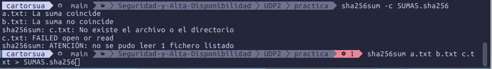
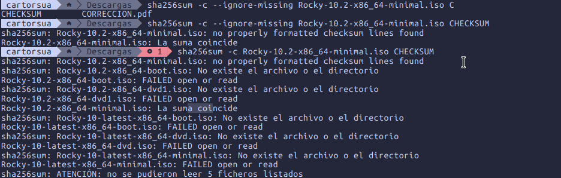
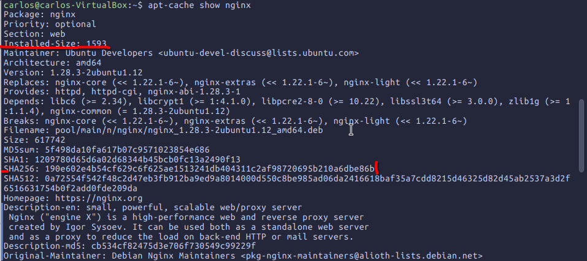
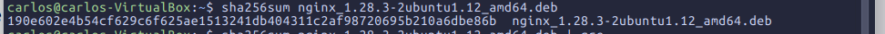
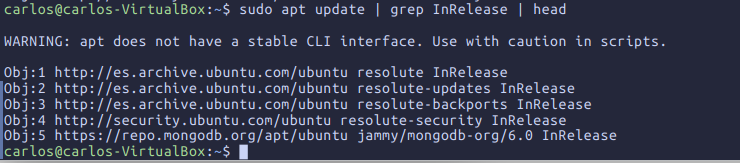
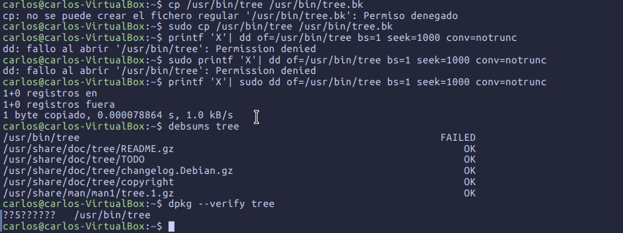
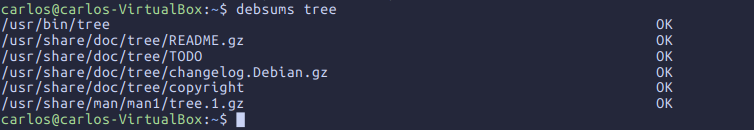
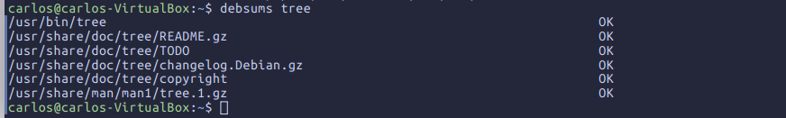
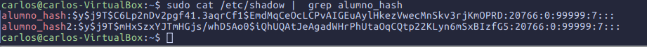
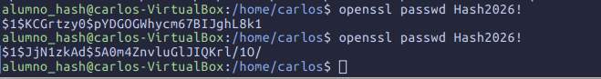

MD5	32 caracteres
SHA-1	40 caracteres
SHA-256	64 caracteres
SHA-512	128 caracteres
b2sum   128 caracteres

openssl dgst -sha256 mensaje.txt
SHA2-256(mensaje.txt)= 3b3c1a1d6319561bd1ebf8c214cd77833e6

# cambie el caracter s de hamburguesa
openssl dgst -sha256 mensaje.txt 
SHA2-256(mensaje.txt)= 6ae8c5e8c5286c171e09017e4ce1a7a4400ec13881b3e9124f91f7fbaea547f4

Compara ambos hashes:
¿cuántos caracteres coinciden en la misma posición? ¿Qué propiedad demuestra esto?
ningun caracter estan en la misma posición todo el hash a cambiado, lo que demuestra el minimo cambio de caracter cambia por completo el hash

5. Genera el hash de la misma cadena con echo y con echo -n. ¿Por qué son diferentes?
Son diferentes porque echo añade un carácter de nueva línea al final de la cadena. En cambio, echo -n no lo añade.

Preguntas:
• a) ¿Es posible “descifrar” un hash? Justifica tu respuesta.
	no se puede descifrar porque el hash generado no se puede revertir pero si se puedes hacer ataques de fuerza bruta para intentar saber el texto ariginal del archivo. 
 ha base de ataques 
• b) ¿Qué es una colisión y por qué MD5 y SHA‑1 se consideran inseguros?
MD5 y SHA-1 se consideran inseguros porque se han encontrado métodos prácticos para generar colisiones:

    MD5: es vulnerable desde hace años, se pueden crear archivos distintos con el mismo hash.
    SHA-1: también tiene colisiones demostradas.

# Apartado 2

5. Borra c.txt y vuelve a verificar. ¿Qué mensaje aparece? Explica la diferencia con el caso
anterior.

 sha256sum -c SUMAS.sha256 
a.txt: La suma coincide
b.txt: La suma no coincide
sha256sum: c.txt: No existe el archivo o el directorio
c.txt: FAILED open or read
sha256sum: ATENCIÓN: no se pudo leer 1 fichero listado

En el anterior apartado dice que el hash no coincide y ahora es que directamente no encuentra el archivo

6. Comprueba cómo se utilizaría la opción --ignore-missing y explica en qué situación real
es útil.

Es util cuando tienes varios y archivos que quieres verificar y sus hash han cambiado para que no salga los errores que no esta el archivo cosa que no quieres ver por terminal tanta veces

# Apartado 3. Verificación de una descarga real

Preguntas:
• a) ¿Por qué no basta con comprobar el hash si lo has descargado del mismo servidor que el
fichero?	
Si un atacante logra comprometer el servidor de descargas, tiene la capacidad de modificar tanto la imagen .iso como el fichero de sumas (SHA256SUMS) para que ambos coincidan con la versión maliciosa introducida. 
Al calcular el hash localmente y compararlo con el fichero de sumas descargado del mismo servidor alterado, el sistema dará por buena una ISO manipulada.
	
• b) Diferencia entre integridad y autenticidad. ¿Qué garantiza cada paso que has realizado?

Integridad: Propiedad que asegura que los datos no han sido alterados, corrompidos o modificados (ni accidental ni maliciosamente) durante su almacenamiento o transmisión.

Autenticidad: Propiedad que valida la identidad del creador o emisor del fichero, garantizando que proviene de una fuente legítima y confiable

Comprobación del hash

# Apartado 4. Verificación de paquetes

3. Descarga el paquete sin instalarlo con apt download y calcula su SHA‑256. ¿Coincide con el
que indica el repositorio?

si coincide con la del repositorio.

# 4.2. Verificación de paquetes instalados

## Apartado 3

Esto indica que el archivo instalado difiere del original del paquete. La copia de seguridad conserva el binario correcto y permite restaurarlo.

## 4.3. Preguntas

a) ¿Por qué usar [trusted=yes] en un repositorio es una mala práctica de seguridad?
desactiva la verificación de autenticidad y firma del repositorio. Un atacante podría introducir paquetes y firma del repositorio. Un atacante podría introducir paquetes maliciosos mediante un repositorio comprometido o un ataque *Man-in-the-Middle*, sin que APT los rechace.

b) ¿Qué limitación tiene debsums frente a un atacante que ya tiene acceso root?
no protege frente a un atacante con acceso `root`: puede modificar los ficheros instalados y también las bases de datos, sumas de comprobación o incluso el propio programa `debsums`. Por tanto, sus resultados podrían falsificarse o evitarse.

# Apartado 5. Hashes de contraseñas en Linux

username: alumno_hash
contraseña: $y$j9T$C6Lp2nDv2pgf41.3aqrCf1$EmdMqCeOcLCPvAIGEuAylHkezVwecMnSkv3rjKmOPRD
fecha del ultimo cambio de contraseña: 20766
edad minima de contraseña: 0
edad maxima de contraseña: 99999
periodo de aviso de caducidad: 7

$y$ --> algoritmo es el yesscript
$j9T$ --> parametros de configuración
$C6Lp2nDv2pgf41.3aqrCf1$ --> salt
$EmdMqCeOcLCPvAIGEuAylHkezVwecMnSkv3rjKmOPRD$ --> hash resultante

## Hash de la misma contraseña
carlos@carlos-VirtualBox:~$ openssl passwd -6 Hash2026!
$6$sH4PgcUdR6G.K3Ro$VYOv5Z5HuY6BKammBTOa5BaHkA1Ks1yjhLRhu5xF2ubc3dEHfBy0W1K4tEXQU8L2SlBFCWyQpp1Kx0RrbG5TA.
carlos@carlos-VirtualBox:~$ openssl passwd -6 Hash2026!
$6$Oz6cpaAvlZl4KLgi$MReyJuK656bJyCYEIZomqsQDT.7anBXR6D7QF2eHQUJzxJXB211Mtp23k9BNG3yzOwjYBts2SSKnRbioqJIU8.
carlos@carlos-VirtualBox:~$ 

Los hash nunca seran iguales porque cada vez se generara uno nuevo por tema de seguridad de que no pueden haber dos hash iguales.

### apartado 4
carlos@carlos-VirtualBox:~$ openssl passwd -salt C6Lp2nDv2pgf41.3aqrCf1 -6 Hash2026!
$6$C6Lp2nDv2pgf41.3$ORzEZNzf1AjdKLsh74/wdTiOddFMCKnEEX/cD4IZqWwaUDupv2PG0F0iM89XMMlyyvykPKQlKTo9KQdP/D1mH.

si obtine la misma salt que el usuario alumno

### apartado 5
solo los dos primeros parametros son iguales, todo los demas es diferente al primer usuario, lo que no cambia son las fechas de minimo y maximo y el cambio de contraseña.

## Preguntas:

a) ¿Por qué se usan algoritmos como yescrypt o bcrypt en lugar de SHA‑256 para
contraseñas?

Es una tabla de consultas precalculadas que asig

b) ¿Qué es una rainbow table y cómo lo neutraliza la sal?

Una tabla rainbow es una tabla de consulta precalculada que asigna valores hash a sus entradas de texto plano originales. En lugar de calcular el hash de cada contraseña posible durante un ataque.
La defensa es el salteo,  agregar un valor aleatorio a cada contraseña antes de aplicarle el hash.

